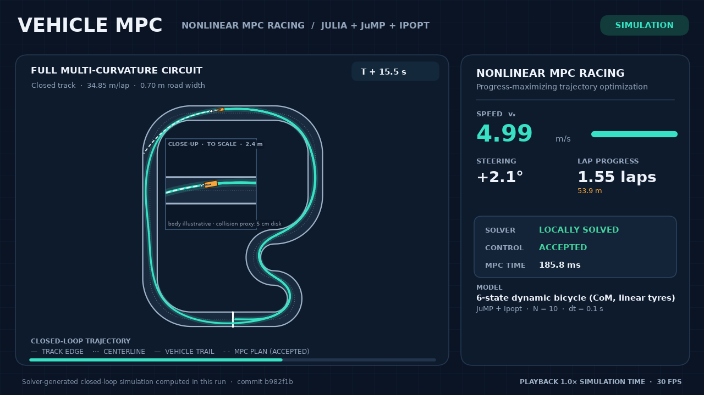
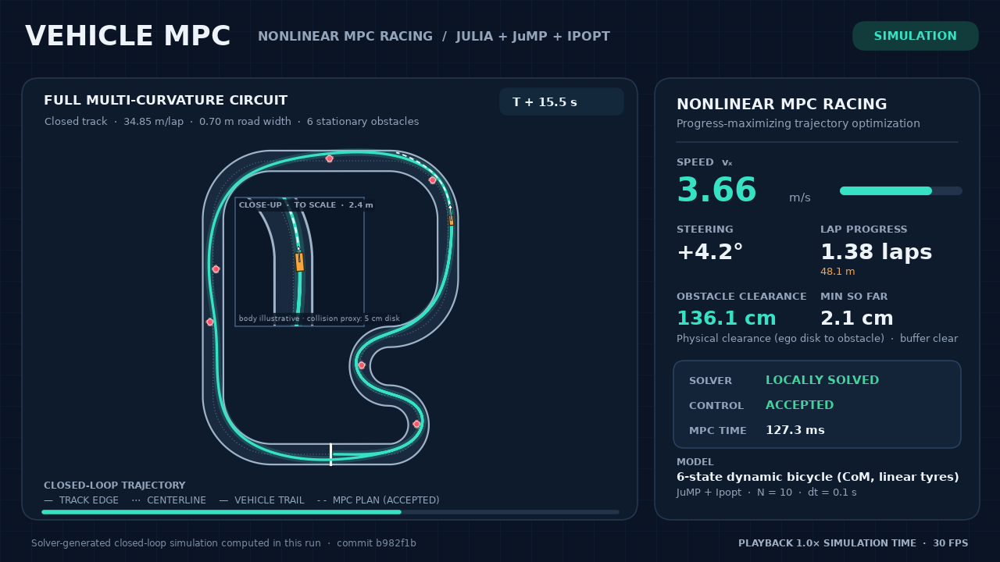

# VehicleMPC

**Model predictive control for autonomous racing and obstacle avoidance in Julia.**

VehicleMPC is a research-oriented framework for planning and tracking vehicle trajectories on winding circuits. It combines nonlinear and successively linearized MPC, kinematic and dynamic bicycle models, and stationary-obstacle avoidance in a reproducible Julia implementation built with [JuMP](https://jump.dev/JuMP.jl/stable/), [Ipopt](https://github.com/jump-dev/Ipopt.jl), and [OSQP](https://osqp.org/).

The controllers optimize **progress along a track** while respecting vehicle and roadway constraints. The objective is minimum-time-*oriented*, not an exact minimum-time formulation.

## See it in action

<p align="center">
  <a href="docs/media/race_dynamic.mp4"></a>
  <a href="docs/media/multiple_obstacles_dynamic.mp4"></a>
</p>

<p align="center">
  <a href="docs/media/race_dynamic.mp4"><strong>▶ Full-track racing</strong></a> &nbsp;·&nbsp;
  <a href="docs/media/multiple_obstacles_dynamic.mp4"><strong>▶ Six-obstacle avoidance</strong></a>
</p>

Both videos show **closed-loop nonlinear MPC with a six-state dynamic bicycle model** on the same 34.85 m multi-curvature circuit, starting from the same physical pose and speed. The second scenario adds six stationary obstacles in straights and turns. The solver is called at every control step; the animated positions and telemetry come from the recorded simulation, with visual interpolation between simulated plant samples. The body graphic is illustrative.

A [kinematic-bicycle racing video](docs/media/race_kinematic.mp4) is also available ([poster](docs/media/race_kinematic_poster.png)).

## What is included

| Controller | Vehicle model | Optimization | Track and obstacle support |
|---|---|---|---|
| **Nonlinear MPC** | Four-state kinematic bicycle | JuMP + Ipopt | Straight and multi-curvature tracks; one stationary circle |
| **Linearized MPC** | Four-state kinematic bicycle | JuMP + OSQP; successive linearization | Straight and multi-curvature tracks; one stationary circle |
| **Dynamic nonlinear MPC** | Six-state dynamic bicycle with lateral tyre forces | JuMP + Ipopt | Multi-curvature tracks; multiple stationary circles constrained simultaneously |

**Shared infrastructure:** piecewise constant-curvature track geometry; Frenet/Cartesian conversions; warm starts; actuator, track, and handling constraints; closed-loop simulation; and independent trajectory validation before a control is accepted.

- **Kinematic MPC** uses a validated exact zero-order-hold Cartesian bicycle map.
- **Dynamic MPC** uses a center-of-mass model with lateral velocity, yaw dynamics, linear axle tyre forces, and RK4 integration.
- **Linearized MPC** uses local affine dynamics and track models, trust regions, and nonlinear rollout checks to validate candidate QP solutions.

Explore the [controller API](docs/api.md), [dynamic model and MPC formulation](docs/dynamic_bicycle_mpc.md), and [linearized MPC formulation](docs/linearized_multicurvature_collision_avoidance.md).

## Results at a glance

The following numbers are from the **individual recorded showcase runs** (25 s simulated time, horizon N = 10, 0.1 s control step; Julia 1.11.5 on one laptop). They are measurements, not guarantees.

| Showcase | Laps in 25 s | Median reported MPC cycle | Cycles within 100 ms | Outcome |
|---|---:|---:|---:|---|
| Dynamic bicycle · racing | **2.56** | 87.5 ms | 78.0% | 250/250 controls accepted |
| Dynamic bicycle · six obstacles | **2.29** | 131.6 ms | 7.2% | 250/250 controls accepted; no physical contact observed |
| Kinematic bicycle · racing | **2.59** | 13.2 ms | 100% | 250/250 controls accepted |

In the six-obstacle run, the minimum **physical disk-to-disk clearance** was **1.94 cm**. The trajectory entered the additional 3 cm planning buffer by up to **1.06 cm** between constrained points. No physical track departures were observed in these runs.

**Real-time qualification:** the dynamic-model showcase runs are **offline simulations**. Computation sometimes exceeded the 100 ms control period; the simulation does not model that computational delay. This project does not claim hard real-time performance or certified collision avoidance. Full per-run statistics and the benchmark methodology are in [`benchmarks/results/dynamic_showcase.md`](benchmarks/results/dynamic_showcase.md).

The recorded videos and table above use the controller's historical internal timer. Fresh showcase runs now measure wall-clock time around the complete `solve!` call, including final bookkeeping, and record that definition in their metadata. Plant simulation, export and rendering are excluded. The historical timing numbers have not been reinterpreted or replaced.

For a separate, matched comparison between **kinematic** nonlinear MPC (Ipopt) and linearized MPC (OSQP), see the [benchmark comparison](docs/benchmark_comparison.md). These results should not be directly compared with the six-state dynamic benchmark as if the models were identical.

## Get started

**Requirements:** Julia 1.10 or newer. Python 3.10+ is needed only to render videos.

```bash
git clone https://github.com/Mahdiss99/VehicleMPC.jl.git
cd VehicleMPC.jl
julia --project=. -e 'using Pkg; Pkg.instantiate()'
```

Run a lightweight linearized-MPC example:

```bash
julia --project=. examples/linear_quarter.jl --cycles=40 --no-time-budget --no-csv
```

Or run a full MPC racing simulation **from the solver**, then render its video:

```bash
python -m pip install -r examples/showcase/requirements.txt

julia --project=. examples/showcase/race.jl --model=dynamic --video
julia --project=. examples/showcase/multiple_obstacles.jl --model=dynamic --video
```

For a four-state kinematic demonstration:

```bash
julia --project=. examples/showcase/race.jl --model=kinematic --video
```

The showcase scripts solve a fresh MPC problem at each control update and export the new run's states, inputs, solver diagnostics, trajectory predictions, and metadata to `examples/showcase/output/`. Use `--no-video` to generate data without rendering, or `--cycles=N` for shorter runs. The multi-obstacle example currently requires `--model=dynamic`; it does not silently substitute a different vehicle model.

See [showcase setup and options](examples/showcase/README.md), including choosing a Python interpreter and reproducing the videos. Recorded website-ready MP4s and posters live in [`docs/media/`](docs/media/).

## Other examples

```bash
julia --project=. examples/linear_straight.jl    # Linearized MPC on a straight
julia --project=. examples/linear_quarter.jl     # Linearized MPC on the circuit
julia --project=. examples/linear_obstacle.jl    # Linearized MPC with one obstacle
julia --project=. examples/nmpc_obstacle.jl      # Nonlinear kinematic MPC with one obstacle
```

Each example reports whether the controller succeeded, along with progress, physical clearances, and full computation-time statistics. For the Julia package API and state conventions, see [`docs/api.md`](docs/api.md).

## Validation and reproducibility

Run the automated test suite:

```bash
julia --project=. -e 'using Pkg; Pkg.test()'
```

Tests cover the bicycle dynamics, derivatives, geometry, nonlinear and linearized controllers, obstacle constraints, solver behavior, closed-loop simulations, and historical regressions. The repository includes a [GitHub Actions workflow](.github/workflows/CI.yml) for Julia 1.10 and 1.11; check the Actions tab for the latest run status.

For technical details and experiments, see the [documentation index](docs/development_history.md), [controller comparison](docs/benchmark_comparison.md), and [numerical showcase report](benchmarks/results/dynamic_showcase.md).

## Scope and limitations

VehicleMPC is **simulation-focused research software**. Its vehicle and tyre parameters are synthetic rather than calibrated to a real car. The vehicle–obstacle collision model uses a disk proxy, and collision checks do not establish continuous-time safety. Ipopt delivers locally optimal solutions; OSQP solves local convex approximations. Neither framework provides a general global-optimality, recursive-feasibility, or hard real-time guarantee. A rejected control stops the simulation rather than invoking a certified fallback.


## License

VehicleMPC.jl is released under the [MIT License](LICENSE).

Copyright © 2026 Mahdis Rabbani.
